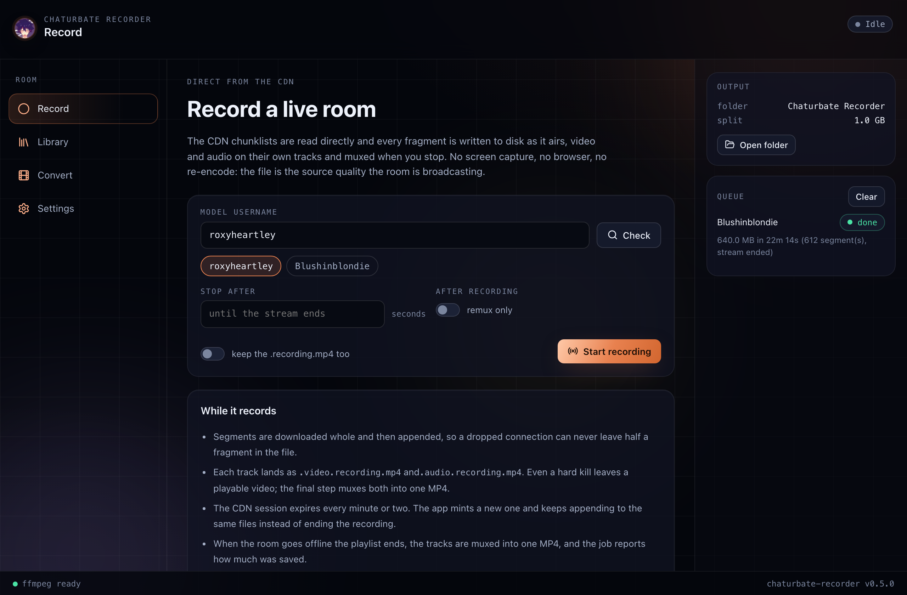
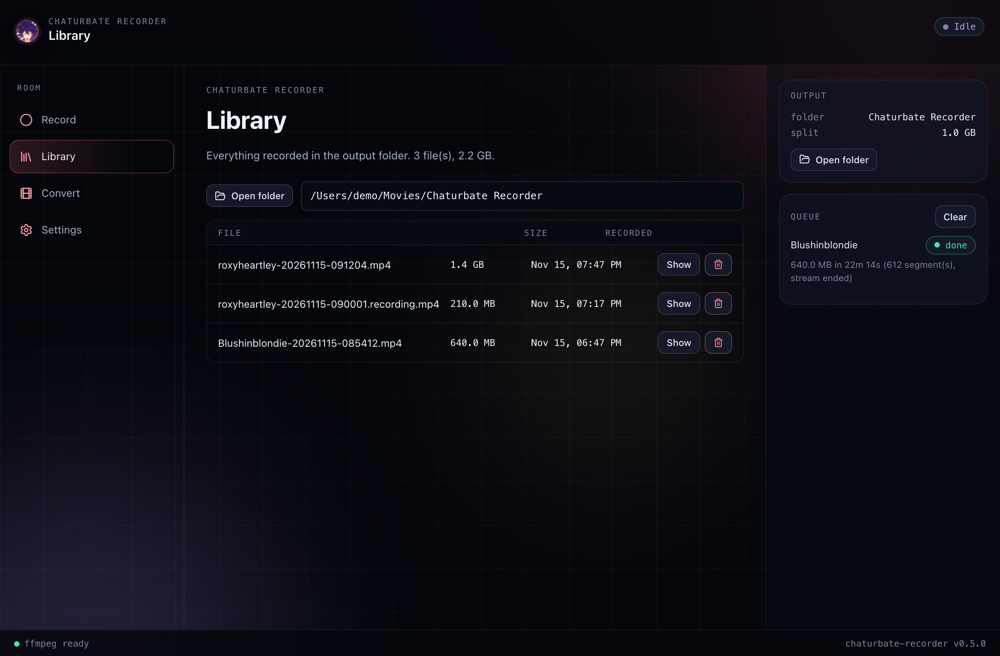

# Chaturbate Recorder

[](https://ghostyshell.github.io/chaturbate-record/)
[](https://discord.gg/d3sFnrgpJn)
[](https://ko-fi.com/ghosty99)
[](https://etherscan.io/address/0xbBef115aD853236a350EaF04777a2AdB2e7c0317)

Record Chaturbate live rooms at source quality, straight from the CDN. No screen
capture, no browser, no re-encode: the app pulls the site's own HLS playlist,
downloads every segment as it airs and writes it to disk.

Same family look and feel as Keepsake Atelier, GODsend 360 and GODsend PSP,
built on the same stack (Rust engine + Tauri 2 + React).

| Record | Library |
| --- | --- |
|  |  |

## Download

<!-- downloads:start -->
Builds are published per release to GoFile (primary) and file.kiwi (backup).
Run `scripts/publish-release.sh` to cut one; the table above is rewritten by
that script.
<!-- downloads:end -->

The desktop builds are not notarized: right-click, Open, Open on first launch
(or `xattr -dr com.apple.quarantine "/Applications/Chaturbate Recorder.app"`).

## Guides

Step-by-step walkthroughs live in [docs/guides](docs/guides/index.md):

1. [Install](docs/guides/install.md)
2. [Recording a room](docs/guides/recording.md)
3. [Library and conversion](docs/guides/library-and-conversion.md)
4. [Troubleshooting](docs/guides/troubleshooting.md)
5. [Build from source](docs/guides/build-from-source.md)

## What it does

- **Record a live room**: type the username, check it is live, pick the source
  variant, record. Video and audio are written as they air.
- **Two tracks, one file**: the CDN serves video and audio as separate fMP4
  chunklists. Both are recorded and muxed into a single MP4 when you stop.
- **Session expiry handled**: a new master and chunklists replace an expired
  session mid-recording, with no gap in the files.
- **Split parts**: rotate to a new file at a size you choose (1 GB by default),
  each part carrying its own init segment.
- **Library and conversion**: list, reveal and delete recordings; remux to a
  clean MP4 or re-encode with the same CRF presets as the rip tools.
- **Crash-safe by construction**: a segment is only appended once it is whole,
  so a dropped connection or a hard kill cannot leave a broken file.

## How it records

The recorder never touches a browser: it speaks HLS to the CDN directly. That
is why the output has no chat, overlays or player chrome in the picture.

Chaturbate has no key layer. Its master playlist URL is single use and the
chunklist `session` token expires every minute or two; the app mints a new
session and keeps appending to the same files.

## Requirements

- **ffmpeg** on `PATH` for the final remux and for compression (the app works
  without it: the recorded file still plays, it is just not remuxed).
- A connection that can reach the CDN. Some addresses are refused by the site
  API; there is a proxy setting for that.

## Build from source

Requirements: Rust 1.85+, Node 20+, and the Tauri 2 prerequisites for your
platform (Xcode CLT on macOS, MSVC + WebView2 on Windows, webkit2gtk-4.1 on
Linux). The full walkthrough is in
[docs/guides/build-from-source.md](docs/guides/build-from-source.md).

```sh
npm install --prefix app
cargo build --release -p chaturbate-recorder-cli        # CLI
npx --prefix app tauri build                # desktop bundles
```

Dev without a network:

```sh
npm run --prefix app dev:mock   # UI with fixture data (?mock=1)
```

CLI quick tour:

```sh
chaturbate-recorder record MODEL --duration 60          # record for a minute
chaturbate-recorder record MODEL --split-size 1G        # rotate at 1 GiB (the default)
chaturbate-recorder record MODEL --output-dir ~/Videos  # choose the folder
chaturbate-recorder presets                             # conversion presets
chaturbate-recorder convert file.mp4 --preset h265_balanced
chaturbate-recorder library                             # what has been recorded
chaturbate-recorder doctor                              # ffmpeg, folder, API
```

## Architecture

```
core/            chaturbate-core: the engine (site client, HLS parsing, the
                 recording loop and its append-only writer, ffmpeg, jobs)
cli/             chaturbate-recorder headless CLI (clap)
app/             Tauri 2 desktop app: React 18 + TypeScript frontend,
                 commands in app/src-tauri, events for job progress
```

See [DESIGN.md](DESIGN.md) for the design system and
[docs/features.md](docs/features.md) for the feature reference.

## License

MIT.
